## lectura de la imagen desde la carpeta 
## 1.no puede cargar la imagen 
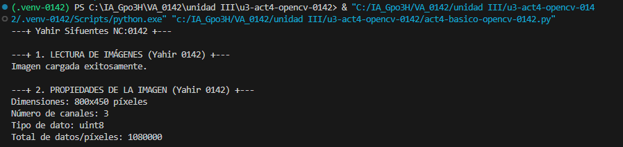
## 2.cuando puede leer la imagen 
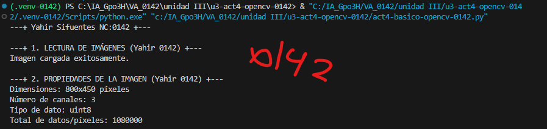
## 3.mostrando imagen origimal
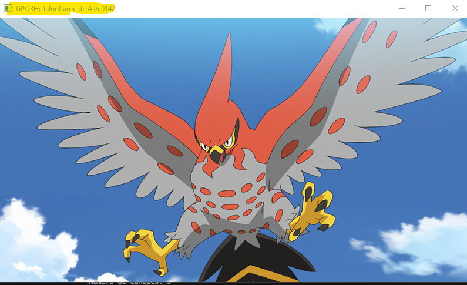
## en la terminal
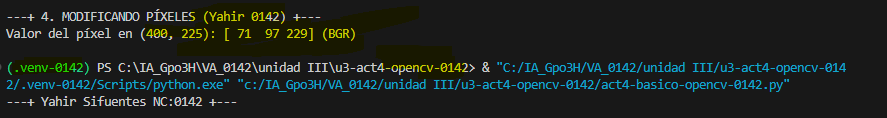
## 4. acceso y modificacion de pixeles individuales 
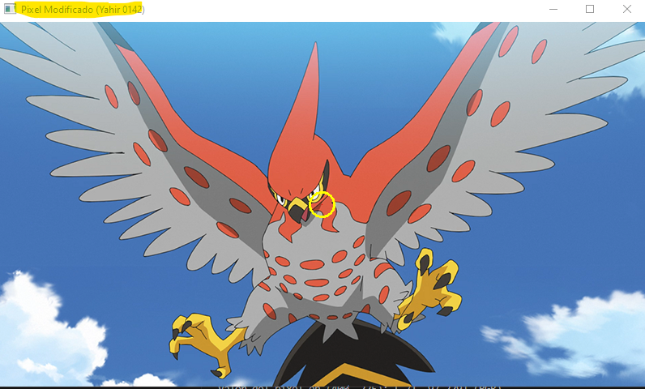
## 5. region de interes (roi region of interes)
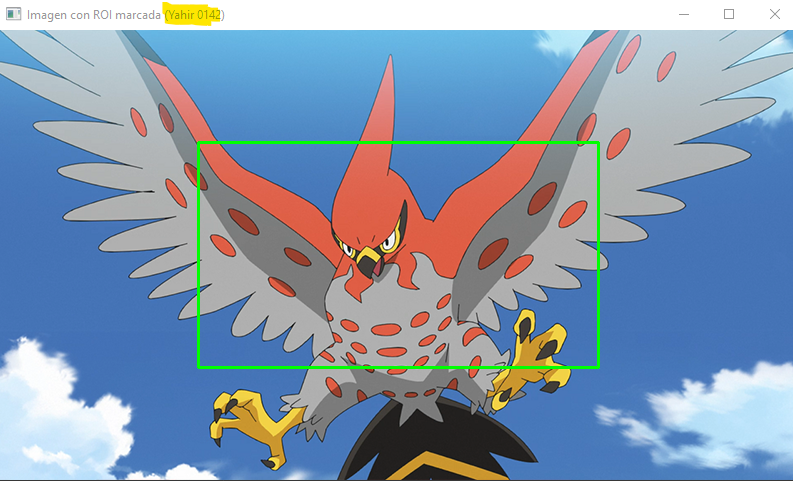
## roi extraida
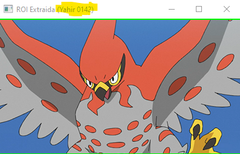
## 6. separacion y fusion de canales de color (bgr)
## canal rojo (grises)
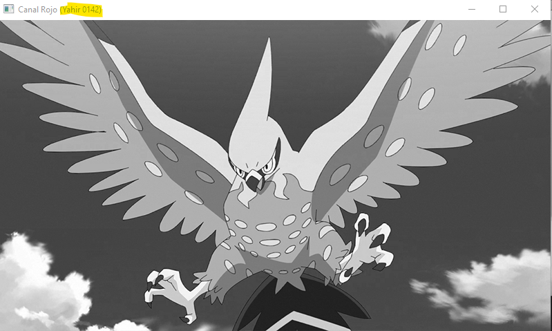
## canal verde (grises)
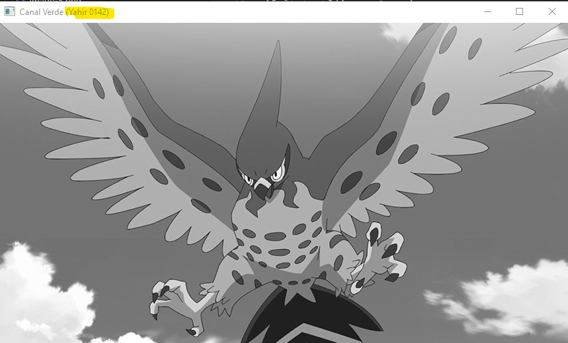
## canal azul (grises)
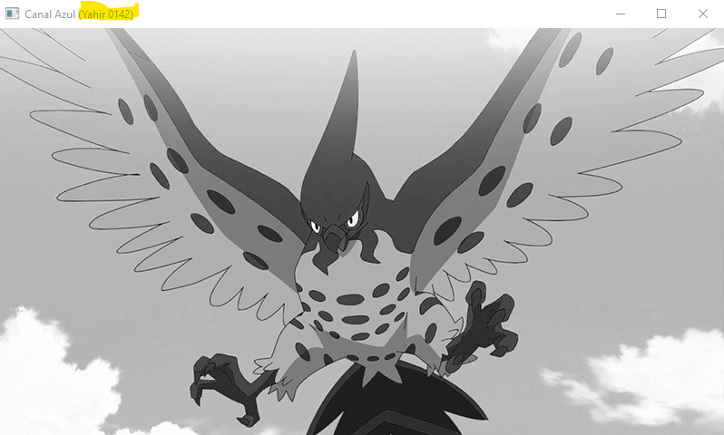
## canal rojo (coloreando)
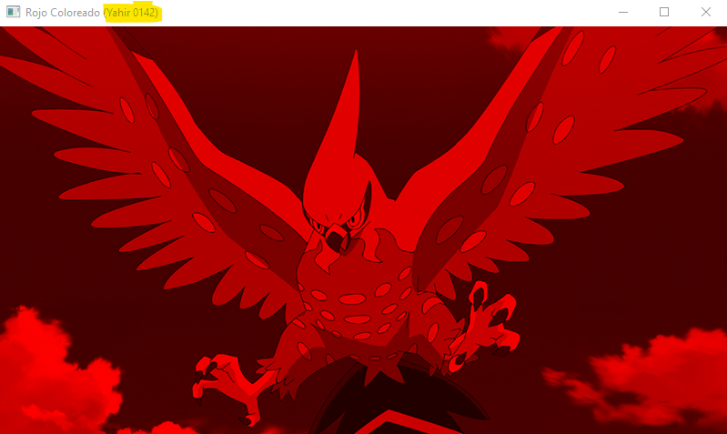
## canal verde (coloreando)
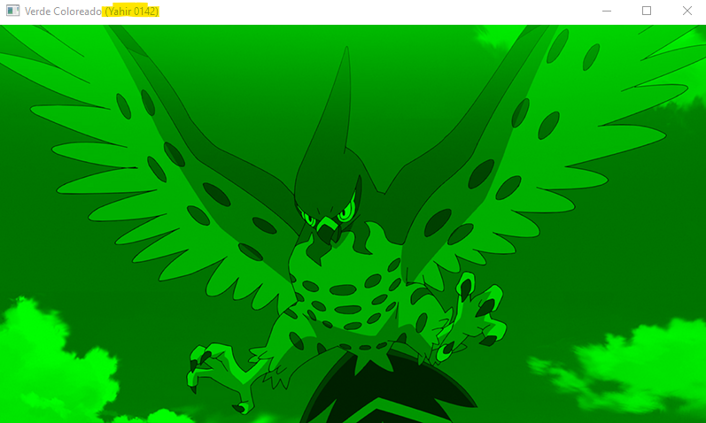
## canal azul (coloreando)
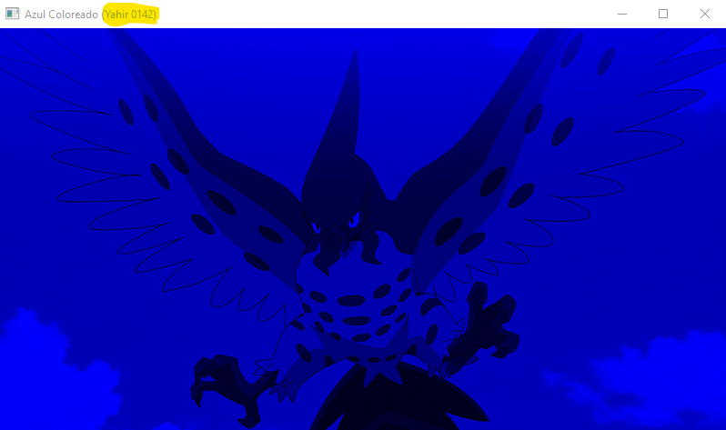
## redimensionamiento de imagenes (reizing)
## img redimensionada 400*300
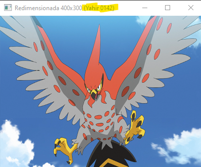
## img redimensionada a 0.5
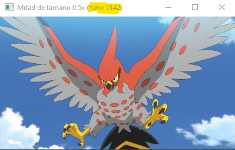
## img redimensionada a 1.5
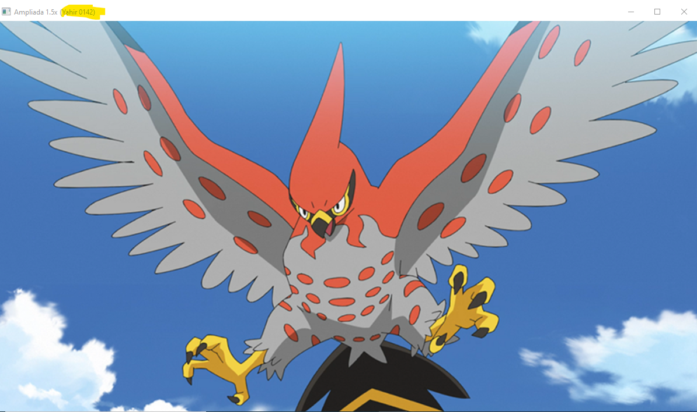
## 8. rotacion de imagenes 
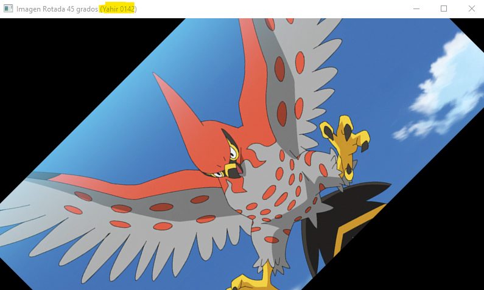
## 9. volteo/espejo de imagenes (flipping)
## volteo en espejo

## volteo de cabeza 
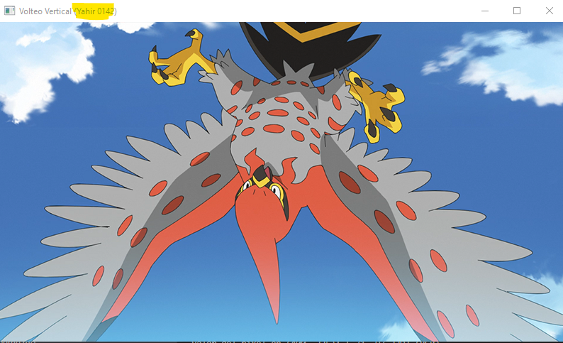
## ambos ejes 
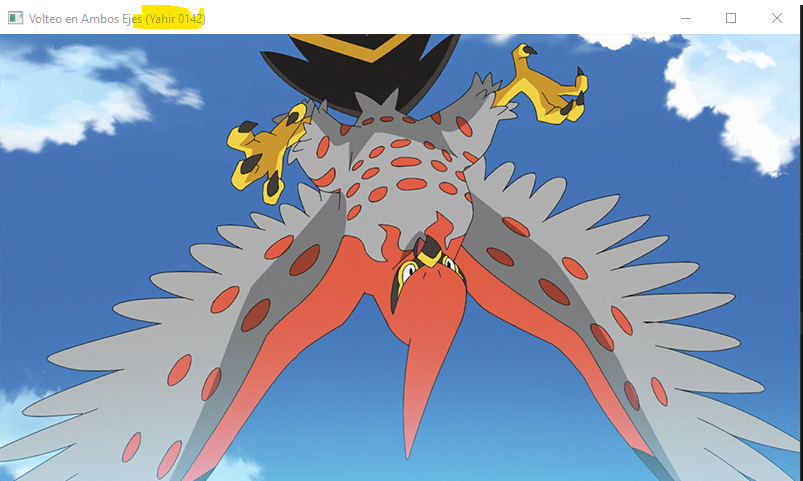
## 10. guardado de resultados y limpieza 
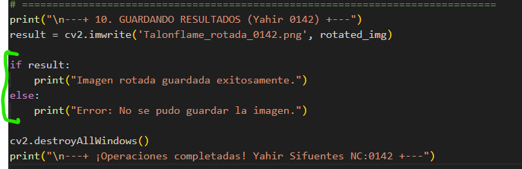
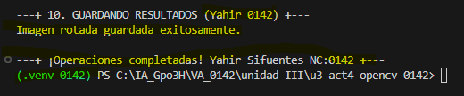

